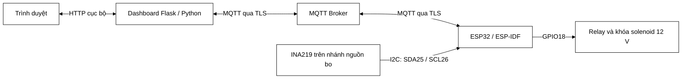

# Hệ thống IoT ESP32 sử dụng AES-128-GCM

Hệ thống điều khiển khóa điện tử qua MQTT/TLS, dùng **AES-128-GCM** bảo vệ payload và so sánh thời gian, công suất, năng lượng ESP32 khi bật/tắt AES.

Dự án gồm firmware ESP-IDF, dashboard Flask, cảm biến INA219 và công cụ sinh payload cho MQTT.fx; phục vụ học tập và thực nghiệm.

## Thông tin nhóm thực hiện

- **Lớp:** D23CQCI01-N
- **Khoa:** Viễn Thông 2
- **Đơn vị:** Học viện Công nghệ Bưu chính Viễn thông

| STT | Họ và tên | Mã số sinh viên |
| --- | --- | --- |
| 1 | **Nguyễn Bình An** | N23DCCI001 |
| 2 | **Nguyễn Quang Minh** | N23DCCI046 |
| 3 | **Đào Duy Nam** | N23DCCI047 |
| 4 | **Phan Bá Pháp** | N23DCCI055 |
| 5 | **Phạm Đoàn Tấn Phát** | N23DCCI056 |

## Mục lục

1. [Chức năng](#chức-năng)
2. [Kiến trúc hệ thống](#kiến-trúc-hệ-thống)
3. [Phần cứng và đấu nối](#phần-cứng-và-đấu-nối)
4. [Cấu trúc thư mục](#cấu-trúc-thư-mục)
5. [Cài đặt và cấu hình](#cài-đặt-và-cấu-hình)
6. [Biên dịch và nạp firmware](#biên-dịch-và-nạp-firmware)
7. [Chạy dashboard](#chạy-dashboard)
8. [Giao thức MQTT và AES-GCM](#giao-thức-mqtt-và-aes-gcm)
9. [Kiểm thử chức năng và bảo mật](#kiểm-thử-chức-năng-và-bảo-mật)
10. [Phương pháp đo hiệu năng](#phương-pháp-đo-hiệu-năng)
11. [Dữ liệu và API](#dữ-liệu-và-api)
12. [Kiểm thử phần mềm](#kiểm-thử-phần-mềm)
13. [Xử lý sự cố](#xử-lý-sự-cố)
14. [Giới hạn và hướng phát triển](#giới-hạn-và-hướng-phát-triển)

## Chức năng

- Điều khiển khóa qua dashboard/MQTT; ghép ACK bằng mã lệnh 16 ký tự HEX.
- **ON:** GPIO18 HIGH, giữ mở. **OFF:** GPIO18 LOW, giữ khóa. Boot/reset ở trạng thái khóa; không tự khóa theo thời gian.
- Đổi AES tại runtime có xác nhận; yêu cầu đổi chế độ luôn dùng AES-GCM và challenge.
- Xem nonce, tag, AAD, ciphertext; thử sửa dữ liệu, replay và payload quá dài.
- Hiển thị V/I/P từ INA219, thời gian mã hóa/giải mã, xử lý GPIO và độ trễ đầu-cuối.
- Lưu lịch sử, số đo vào SQLite; lọc, xuất CSV và so sánh thời gian, năng lượng giữa hai chế độ.
- Dùng `--offline` để xem giao diện mà không kết nối broker hoặc phát lệnh.

## Kiến trúc hệ thống



Python mã hóa payload. ESP32 xác thực tag, timestamp và cấu trúc lệnh, sau đó đưa vào hàng đợi, đặt GPIO và gửi ACK kèm mã lệnh/số đo. Dashboard xác nhận thực thi khi ACK khớp lệnh chờ.

TLS bảo vệ kết nối client–broker; AES-GCM bảo vệ payload điều khiển Python–ESP32. **TLS vẫn bật khi tắt AES**. Status/telemetry dùng JSON qua TLS, chưa có AES-GCM ở tầng ứng dụng.

## Phần cứng và đấu nối

| Thành phần | Vai trò / cấu hình |
| --- | --- |
| ESP32 Xtensa | Firmware, Wi-Fi, MQTT/TLS, AES-GCM |
| Relay tương thích ESP32 | Điều khiển khóa qua GPIO18 |
| Solenoid 12 V và nguồn | Tải đóng/mở qua tiếp điểm relay |
| INA219 | Đo nguồn bo, I2C `0x40`, shunt `0,1 Ω` (R100) |
| Máy tính, USB/UART | Build, nạp firmware, chạy dashboard |
| MQTT broker TLS | Kết nối ESP32 và Python, cổng mặc định `8883` |

| Tín hiệu | Kết nối |
| --- | --- |
| Relay | GPIO18 |
| INA219 SDA / SCL | GPIO25 / GPIO26 |
| INA219 VCC / GND | 3V3 / GND chung ESP32 |
| Nhánh đo dòng | Nguồn 5 V → VIN+ INA219 → VIN− → đầu 5 V bo |

Nguồn solenoid 12 V đi qua tiếp điểm relay, không cấp vào GPIO/3V3. Khi đo năng lượng bo, đặt relay/solenoid ngoài nhánh đo và tránh USB cấp điện vòng qua INA219, kể cả khi dùng UART.

Ghi rõ các tải thực tế dùng chung nguồn khi báo cáo kết quả.

Nếu thay relay hoặc đấu COM–NO/COM–NC khác, kiểm tra `DOOR_UNLOCK_LEVEL` và `DOOR_LOCK_LEVEL` trong `main/hardware_control.h`. ACK xác nhận GPIO, chưa xác nhận vị trí chốt.

## Cấu trúc thư mục

```text
.
├── CMakeLists.txt                 # Dự án ESP-IDF AES_GCM
├── sdkconfig.defaults            # Cấu hình mặc định
├── sdkconfig.perf                # Cấu hình đo đối chứng
├── requirements.txt              # Thư viện Python
├── .env.example                  # Mẫu môi trường dashboard
├── generator.py                  # Sinh payload MQTT.fx
├── main/
│   ├── main.c, wifi_app.[ch]     # Khởi tạo, kết nối Wi-Fi
│   ├── mqtt_app.[ch]             # MQTT/TLS, ACK, telemetry
│   ├── crypto_app.[ch]           # AES-GCM, timestamp, đổi chế độ
│   ├── hardware_control.[ch]     # Hàng đợi, GPIO relay
│   ├── ina219_app.[ch]           # Driver, chẩn đoán INA219
│   ├── cycle_energy.[ch]         # Đo, tích phân năng lượng
│   ├── web_server.py             # Dashboard, SQLite, API
│   ├── cycle_energy_web.py       # Điều phối đo năng lượng
│   ├── perf_measure.py           # Đo batch với thiết bị thật
│   ├── *_panel.html, static/     # Giao diện, font và giấy phép
│   ├── emqxsl-ca.crt             # CA công khai cho TLS
│   └── *.local.h.example         # Mẫu Wi-Fi/MQTT
├── tests/                        # Mã kiểm thử Python mô phỏng
├── docs/                         # Hướng dẫn tổ chức phép đo năng lượng
└── .devcontainer/                # Môi trường ESP-IDF tham khảo
```

## Cài đặt và cấu hình

### 1. Môi trường

- ESP-IDF **v5.5.5**, toolchain `esp32`, CMake, Ninja và driver USB/UART.
- Python **3.12** và thư viện trong `requirements.txt`.
- Wi-Fi 2,4 GHz, broker TLS, tài khoản có quyền publish/subscribe topic dự án.
- MQTT.fx hoặc client tương đương để gửi thủ công.

Chạy lệnh từ thư mục gốc. Trên Windows, dùng ESP-IDF Terminal và lệnh kích hoạt venv tương ứng.

### 2. Thư viện Python

```bash
python3 -m venv .venv
source .venv/bin/activate
python -m pip install -r requirements.txt
```

PowerShell: `.venv\Scripts\Activate.ps1`.

### 3. Wi-Fi và MQTT trên ESP32

```bash
cp main/wifi_credentials.local.h.example main/wifi_credentials.local.h
cp main/mqtt_config.local.h.example main/mqtt_config.local.h
```

Điền SSID/mật khẩu, URI `mqtts://<broker>:8883` và tài khoản MQTT. Hai file `.local.h` đã được Git bỏ qua; thay đổi cần build/flash lại.

`main/emqxsl-ca.crt` là CA công khai kiểm tra TLS. Nếu đổi CA broker, cập nhật file này và CA Python rồi nạp lại firmware; giữ xác minh chứng chỉ.

### 4. Dashboard

```bash
cp .env.example .env.local
# Sửa cấu hình broker trước khi nạp biến môi trường.
set -a
source .env.local
set +a
```

Dashboard tự tải `.env.local` từ thư mục gốc dự án khi khởi động. Biến môi trường đã đặt trong terminal được ưu tiên. Tệp hỗ trợ `NAME=value` và `export NAME='value'`, không thực thi lệnh shell hay nội suy biến. Khi đổi cấu hình, khởi động lại dashboard.

| Biến | Ý nghĩa |
| --- | --- |
| `MQTT_BROKER` | Hostname, không kèm `mqtts://` |
| `MQTT_PORT` | Cổng TLS, mặc định `8883` |
| `MQTT_USER`, `MQTT_PASS` | Tài khoản broker |
| `MQTT_CA_FILE` | CA, mặc định `main/emqxsl-ca.crt` |
| `AES_KEY_HEX` | Khóa 16 byte, đúng 32 ký tự HEX |
| `DASHBOARD_DB` | SQLite, mặc định `main/iot_history.sqlite3` |
| `MQTT_TLS_KEYLOG` | Xuất TLS session keys để quan sát trong lab |

Khóa mặc định là **khóa thử nghiệm công khai** `0102030405060708090A0B0C0D0E0F10`. Khi đổi, cập nhật `s_system_key` trong `main/crypto_app.c`, `AES_KEY_HEX` của Python/generator và khóa self-test nếu cần. Biến môi trường không đổi khóa ESP32.

## Biên dịch và nạp firmware

Kích hoạt ESP-IDF bằng Terminal hoặc `export.sh`, sau đó:

```bash
idf.py --version
idf.py -B build-perf -DSDKCONFIG=sdkconfig.perf build
python -m serial.tools.list_ports
idf.py -B build-perf -DSDKCONFIG=sdkconfig.perf -p <PORT> flash monitor
```

Thay `<PORT>` bằng cổng thật: `/dev/cu.usbserial-10` (macOS), `/dev/ttyUSB0` (Linux), `COM3` (Windows). Thoát monitor: **Ctrl+]**.

`sdkconfig.perf` đã chọn `esp32`; bản sao sạch không cần `set-target`.

Cấu hình đo: CPU **240 MHz**, compiler **PERF**, log **WARN**, hardware AES bật, MQTT poll **10 ms**, Wi-Fi `WIFI_PS_NONE`. Giữ `-DSDKCONFIG=sdkconfig.perf`; so sánh hai chế độ trên cùng firmware, cấu hình, nguồn và tải.

Đo lại cả hai chế độ sau khi thay firmware hoặc thiết lập đối chứng.

## Chạy dashboard

Trong terminal đã kích hoạt venv và nạp biến môi trường:

```bash
python main/web_server.py
```

Mở **http://127.0.0.1:5000**. Dùng `--port 5001` nếu trùng cổng. Xem offline với database riêng:

```bash
DASHBOARD_DB=/tmp/esp32-preview.sqlite3 python main/web_server.py --offline --port 5001
```

1. Cấp nguồn, kiểm tra trạng thái khóa và kết nối Wi-Fi/MQTT.
2. Chờ dashboard nhận trạng thái/chế độ AES từ ESP32.
3. Gửi ON/OFF; chờ ACK trước lệnh tiếp theo.
4. Khi đổi AES, chờ xác nhận rồi mới gửi theo chế độ mới; không cần flash lại.
5. Xem lịch sử, thông số thời gian, năng lượng và xuất CSV.

Server mặc định chỉ nghe localhost; `--host` đổi địa chỉ. Dashboard chưa có đăng nhập/phân quyền, cần bổ sung trước khi triển khai ngoài lab. Khởi động lại server sau khi sửa Python/template.

## Giao thức MQTT và AES-GCM

### Topic

| Topic | Chiều | Nội dung |
| --- | --- | --- |
| `device/esp32/control` | Python/client → ESP32 | ON/OFF thuần hoặc AES |
| `device/esp32/status` | ESP32 → Python | Trạng thái, ACK, lỗi, chế độ/challenge |
| `device/esp32/telemetry` | ESP32 → Python | V/I/P, trạng thái và chẩn đoán cảm biến |
| `device/esp32/config/aes` | Python → ESP32 | `GET` hoặc đổi AES có xác thực |
| `device/esp32/cycle-energy/request` | Python → ESP32 | START/ABORT có xác thực |
| `device/esp32/cycle-energy/result` | ESP32 → Python | Kết quả đợt đo |

Gửi lệnh với **retain=false**. Status/ACK và kết quả đợt dùng QoS 1; telemetry dùng QoS 0. Retained message không xác nhận lần thực thi mới.

### Payload điều khiển

AES-128 dùng khóa 16 byte, nonce 12 byte, tag 16 byte. AAD là Unix timestamp unsigned 8 byte, **little-endian**. MQTT gửi **văn bản HEX**:

```text
HEX( Nonce[12] | Tag[16] | Timestamp/AAD[8] | Ciphertext[N] )
```

Bản rõ: `ON`, `OFF`, `ON:<command_id>` hoặc `OFF:<command_id>`. Mã lệnh đúng 16 ký tự HEX, nằm trong ciphertext khi bật AES.

| Bản rõ | Gói nhị phân | Chuỗi HEX |
| --- | ---: | ---: |
| `ON` | 38 byte | 76 ký tự |
| `OFF` | 39 byte | 78 ký tự |
| `ON:<16HEX>` | 55 byte | 110 ký tự |
| `OFF:<16HEX>` | 56 byte | 112 ký tự |

Giới hạn MQTT **256 ký tự**: tối đa 128 byte nhị phân, 92 byte ciphertext sau overhead 36 byte. Chỉ cấu trúc ON/OFF hợp lệ được thực thi. Tắt AES thì gửi bản rõ, không HEX hóa.

### Xác thực và tính mới

ESP32 xác thực tag trước khi dùng bản rõ/timestamp; từ chối gói ngoài **±10 giây**. Nếu đồng hồ chưa hợp lệ, firmware lấy timestamp từ gói đã xác thực; chưa có nguồn thời gian độc lập. Chưa lưu nonce/mã lệnh đã dùng nên replay trong cửa sổ vẫn có thể được nhận.

Các yêu cầu sau luôn dùng AES-GCM, kể cả khi AES điều khiển tắt:

- Đổi chế độ: `AES=0:<id16>:<challenge32>` hoặc `AES=1:<id16>:<challenge32>`.
- Đo năng lượng: `START:<id16>:<cycles>:<challenge32>`, `ABORT:<id16>:<challenge32>`.

AAD là `timestamp8 + topic yêu cầu`; challenge thay sau khi yêu cầu được chấp nhận.

## Kiểm thử chức năng và bảo mật

Các kịch bản dashboard có thể điều khiển khóa thật; chuẩn bị tải phù hợp.

| Kịch bản | Thao tác | Kết quả |
| --- | --- | --- |
| Hợp lệ | Gửi ON/OFF ở hai chế độ | GPIO đúng, ACK khớp mã |
| Quan sát | So sánh payload AES bật/tắt | Ciphertext/bản rõ; TLS luôn bật |
| Sửa dữ liệu | Đảo bit ciphertext, giữ tag | `AUTH_FAIL`, không thực thi |
| Sai khóa/tag | Gửi gói xác thực lỗi | Từ chối, không cập nhật GPIO |
| Replay | Phát lại nguyên gói | Có thể nhận trong cửa sổ; ngoài cửa sổ: `REPLAY_REJECT` |
| Sai cấu trúc/quá dài | Gửi lỗi hoặc >256 ký tự | Từ chối; timeout không tính là 0 |

Xem nội dung bằng payload inspector hoặc MQTT client. Bắt gói thường chỉ thấy TLS; `MQTT_TLS_KEYLOG` hỗ trợ giải mã phiên Python khi cấu hình công cụ phù hợp, không xuất khóa phiên ESP32.

### Sinh payload cho MQTT.fx

```bash
python generator.py
python generator.py ON --raw
python generator.py OFF --raw
python generator.py ON --tamper
python generator.py ON --aes off
```

Generator chỉ tạo payload. Gửi tới `device/esp32/control` dạng TEXT, retain tắt, không thêm nháy/khoảng trắng/newline. Gói AES cần publish ngay; `--aes off` yêu cầu đổi chế độ và nhận xác nhận trước.

Lệnh generator không có mã lệnh nên thiếu số đo tương quan từng lệnh. Thử replay bằng **nguyên gói cũ**.

## Phương pháp đo hiệu năng

### Thời gian

| Chỉ số | Phạm vi |
| --- | --- |
| `encrypt_us` | Python: tạo đối tượng và gọi AESGCM; không gồm nonce/HEX/MQTT |
| `decrypt_us` | ESP32: init, setkey, xác thực–giải mã, free context |
| `execution_ms` | Nhận đủ MQTT → GPIO; gồm giải mã, kiểm tra, chờ hàng đợi |
| `rtt_ms` | Python: trước publish → ACK khớp lệnh |
| `e2e_ms` | Python: trước chuẩn bị/mã hóa → ACK GPIO; gồm đóng gói và mạng |

E2E dùng `perf_counter_ns()` trên cùng máy Python, không cần đồng bộ ESP32; không gồm HTTP, render hoặc chuyển động chốt. Thiếu trường đo, gửi lỗi, bị từ chối hoặc quá hạn 8 giây không sinh mẫu 0. Loại tamper/replay/oversize khỏi E2E hợp lệ; lưu RTT, xử lý ESP32 và E2E riêng.

Thống kê N/min/mean/P95/max theo số mẫu hợp lệ từng chỉ số; dữ liệu cũ thiếu trường để trống. Chỉ đo ON/OFF, chưa benchmark nhiều kích thước payload.

### Năng lượng chu kỳ ON/OFF

Trang năng lượng chạy **1–100 chu kỳ/đợt**, **1–5 cặp** AES bật/tắt, đảo thứ tự giữa các cặp. Mỗi chu kỳ gồm ON và OFF có ACK; mở web không tự đo.

Trước mỗi đợt, hệ thống xác nhận chế độ và gửi OFF chuẩn bị ngoài cửa sổ. ESP32 đo từ khi ráp đủ ON đầu tiên, trước HEX/AES, đến GPIO OFF cuối. Python gửi tuần tự, chờ ACK khớp mã/lệnh/chế độ; không thêm thời gian giữ chủ động. Mạng và lịch RTOS vẫn nằm trong cửa sổ.

INA219 lấy mẫu khoảng 20 ms, tích phân hình thang theo timestamp thực, giữ giá trị biên; ghi lỗi, độ phủ, max gap, V/I/P trung bình và cấu hình runtime.

Chỉ tính `E/N` theo chu kỳ, `E/(2N)` theo lệnh khi:

- Đủ `2N` ACK đúng mã/thứ tự, không trùng, mất mạng, can thiệp hoặc hủy.
- ≥30 mẫu, ≥1 giây, không lỗi sensor, max gap ≤100 ms, độ phủ ≥90%.
- Điện áp trung bình 4–5,5 V, công suất dương, dữ liệu nhất quán.

Đợt lỗi giữ nguyên lý do, không chuẩn hóa số lệnh thiếu. Chỉ ghép hai đợt hợp lệ; CI95% Student-t từ 2–5 cặp, dưới 3 cặp là thăm dò. CI chưa gồm sai số INA219; chứa 0 nghĩa là chưa phân biệt được hai chế độ.

Đây là **năng lượng toàn bo trong đợt**, gồm Wi-Fi/chờ mạng/tải chung nhánh; không phải năng lượng riêng AES hoặc Python. Năng lượng/lệnh gộp ON+OFF. Không gửi từ client khác khi đo. Dừng sẽ chờ OFF chu kỳ hiện tại rồi hủy, thử khôi phục OFF/chế độ ban đầu và ghi tình trạng xác nhận. Firmware hủy khi chờ ON đầu >30 giây hoặc cửa sổ >600 giây.

## Dữ liệu và API

SQLite tự tạo tại `main/iot_history.sqlite3`:

- `events`: lịch sử lệnh, phản hồi, sự kiện.
- `measurements`: số đo thời gian, điện áp/dòng điện/công suất, mã lệnh, chế độ và kết quả.
- `cycle_sessions`, `cycle_blocks`, `cycle_commands`: phiên, đợt, lệnh năng lượng.

Không xóa SQLite hoặc `-wal`/`-shm` khi ứng dụng chạy. Lưu minh chứng bằng bản sao nhất quán hoặc CSV.

Đây là dữ liệu và nhật ký giao dịch, không phải cache; các file runtime đã được Git bỏ qua.

| API | Chức năng |
| --- | --- |
| `GET /api/state` | MQTT, thiết bị, chế độ, số đo mới nhất |
| `GET /api/history`, `/api/history.csv` | Lịch sử theo `date=YYYY-MM-DD` |
| `GET /api/performance`, `/api/performance.csv` | Số đo theo ngày, `mode=all/on/off` |
| `POST /api/control` | Gửi lệnh/kịch bản |
| `POST /api/mode` | Đổi AES có xác nhận |
| `GET /api/cycle-energy` | Trạng thái/kết quả năng lượng |
| `POST /api/cycle-energy/start`, `/api/cycle-energy/stop` | Bắt đầu/dừng đo |
| `GET /api/cycle-energy.csv?session=<id>` | CSV đợt đo |
| `GET /api/cycle-energy-commands.csv?session=<id>` | CSV lệnh trong phiên |

POST cần `X-CSRF-Token` của phiên, giao diện tự gửi; token không thay đăng nhập. Ngày/giao diện dùng UTC+7. Thống kê ngày giới hạn bản ghi; báo cáo theo đúng session, tách OFF chuẩn bị/khôi phục.

## Kiểm thử phần mềm

```bash
python -m unittest discover -s tests -v
```

Kiểm thử mô phỏng ACK, thời gian/E2E, telemetry lỗi, cấu hình cục bộ, tương thích database cũ, chất lượng và điều phối năng lượng; không cần broker/ESP32. Build firmware và thử đấu dây/relay/chốt trên thiết bị là bước riêng.

Công cụ batch:

```bash
python main/perf_measure.py --help
python main/perf_measure.py --count 200 --warmup 10 --skip-energy
```

Batch **phát lệnh thật**, dùng biến môi trường broker và database riêng theo `--db`. Chuẩn bị phần cứng, không thao tác client khác đồng thời.

Kiểm thử mô phỏng không xác nhận đấu dây hoặc chuyển động cơ khí. Sau khi flash, kiểm tra trực tiếp trạng thái relay và khóa.

## Xử lý sự cố

| Hiện tượng | Kiểm tra |
| --- | --- |
| Thiếu `idf.py` | Kích hoạt ESP-IDF Terminal/`export.sh` |
| Thiếu module Python | Kích hoạt venv, cài `requirements.txt` |
| Không flash được | Cổng, cáp USB, đóng monitor giữ cổng |
| MQTT chưa kết nối | Wi-Fi, host/cổng, CA, tài khoản/quyền topic, biến môi trường |
| Công tắc bị khóa | Phản hồi mới, `MODE_STATE`, challenge, firmware/kết nối |
| `AUTH_FAIL` | Khóa 16 byte trùng nhau, thứ tự trường, gửi TEXT |
| `REPLAY_REJECT` | Gói quá ±10 giây hoặc lệch giờ Python |
| INA219 thiếu dữ liệu | Nguồn, SDA25/SCL26, `0x40`, R100; xem `sensor_stage`, `sensor_error_name`, `bus_raw`, `shunt_raw` |
| Năng lượng lỗi | Nguồn qua INA219, USB đi vòng, số lệnh/mẫu, thời lượng, max gap |
| Giao diện cũ | Khởi động lại Flask đúng thư mục, tải lại trang |

Sensor lỗi hiển thị null/“—”, không dùng số cũ hoặc 0. Log WARN ẩn thông báo INFO; giữ cùng mức log khi so sánh.

## Giới hạn và hướng phát triển

- Chống replay cần nonce/counter hoặc lưu mã lệnh đã dùng.
- Khóa thử nghiệm trong nguồn; cần cấp phát, luân chuyển và lưu khóa phần cứng.
- ACK/status/telemetry dựa vào TLS và quyền broker, chưa có AES-GCM riêng.
- Cần đăng nhập, phân quyền và cảm biến xác nhận chốt.
- INA219 phụ thuộc shunt 0,1 Ω, đấu nguồn và hiệu chuẩn.
- Chưa đánh giá định lượng chi phí bộ nhớ của AES-GCM; cần xây dựng và kiểm chứng phép đo heap/stack trong điều kiện tương đương giữa hai chế độ.
- Chênh E2E gồm mạng; chênh năng lượng phản ánh AES tích hợp và độ dài payload, chưa tách riêng thuật toán.

Tham khảo: [kế hoạch đo năng lượng](docs/measurement-notes-v3.md).

## Quản lý tệp trong Git

Repository chứa mã nguồn, giao diện, kiểm thử, cấu hình mẫu và tài liệu sử dụng. Các thư mục `build/`, `build-*/`, `output/`, `tmp/`, cache, database đo và cấu hình riêng đã được loại khỏi Git bằng `.gitignore`.

Giữ `.env.local`, `main/wifi_credentials.local.h` và `main/mqtt_config.local.h` trên máy để vận hành; chỉ đưa các file `.example` lên GitHub. Sau khi xoá build, chạy lại lệnh biên dịch để tạo firmware và dữ liệu hỗ trợ trình soạn thảo.
